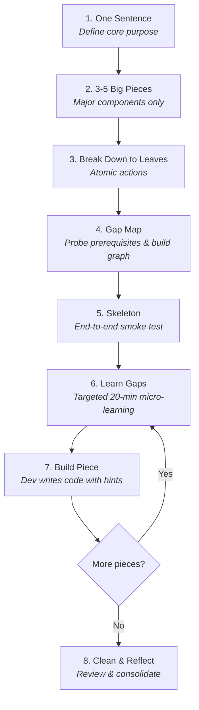

# tiny-pieces

> **Coach a developer or student through building or learning anything one tiny piece at a time, mapping and filling their knowledge gaps along the way.**

An open [Agent Skill](https://skills.sh) for AI coding assistants (Claude Code, Cursor, OpenCode, Antigravity, and any agent supporting `SKILL.md`).

---

## ⚡ Quick Install

Install into your project or agent environment via the [skills.sh](https://skills.sh) package manager:

```bash
# Add to your current project
npx skills add 10d3/tiny-pieces

# Or install globally across all supported agents
npx skills add 10d3/tiny-pieces -g
```

---

## 💡 The Philosophy

> *"You don't code ideas. You code tiny pieces of ideas, one at a time, until the idea is done. When a piece is too hard, a smaller concept under it is missing."*

Most AI coding assistants act as **code vending machines**: you ask for a feature, they dump 300 lines of code, and you understand none of it. Next time you encounter a problem, you are stuck again.

**`tiny-pieces` turns your AI into an active tutor and engineering coach.**
1. **Keeps you on the process:** Enforces an 8-step build protocol with strict exit checks.
2. **Maps your gaps:** Turns *"I don't get this"* into a concept graph, finds the root prerequisite, and tests with diagnostic probes.
3. **The Help Ladder:** Gives progressive hints first; never solves the problem for you unless you are genuinely stuck after multiple attempts.
4. **Persistent Memory:** Stores your verified knowledge profile and prerequisite graphs in `~/.tiny-pieces/` so any AI agent you use shares the exact same memory without re-probing concepts you've already mastered.

---

## 🧭 The 8 Steps

The workflow follows a repeatable rhythm: **map → skeleton → (learn a piece's gaps → build that piece) repeated for each piece**.



| Step | Focus | Exit Check |
|---|---|---|
| **1. One Sentence** | What to build or learn in one clear sentence. | Could a stranger read it and immediately understand the outcome? |
| **2. 3-5 Big Pieces** | Core architectural components. | Exactly 3 to 5 pieces (neither too shallow nor too detailed). |
| **3. Break Down** | Decompose each piece until every leaf is actionable right now. | Can you write each leaf immediately without looking anything up? |
| **4. Gap Map** | Turn unready leaves into concepts, probe prerequisites, identify gaps. | Every gap descends to a verified knowledge floor. |
| **5. Skeleton** | Scaffold minimal end-to-end plumbing. | Does the skeleton run and link all pieces together? |
| **6. Learn Gaps** | Address missing concepts for the active piece (scoped to ~20 min). | Pass a separate exit exercise (different from the probe). |
| **7. Build Piece** | Implement the active piece. Dev types; agent hints. | Piece passes verification and tests. |
| **8. Clean & Reflect** | Remove debug scaffolding, reflect on learning, log progress. | Goal is fully working and knowledge profile is updated. |

---

## 🗂️ Global Shared State (`~/.tiny-pieces/`)

All learning profiles, prerequisite trees, and goal maps live **outside the project folder** in `~/.tiny-pieces/`:

```text
~/.tiny-pieces/
├── knowledge.md        # Verified concept knowledge + global prerequisite graph
├── probes.md           # Custom probes added over time
└── maps/
    └── <goal-slug>.md  # Gap map and step progression for each goal
```

Because state is stored centrally, you can switch between agents (e.g. Claude Code in CLI, Cursor in editor, or Antigravity) seamlessly.

### Atomic CLI Helper (`scripts/tp.py`)

A pure standard-library Python 3 tool (`scripts/tp.py`) ensures that file operations are atomic and protected against concurrent multi-agent access:

```bash
# Check current level and top weak spots
python3 scripts/tp.py summary

# Inspect prerequisite tree for a concept
python3 scripts/tp.py tree "derivative"

# Check the next recommended action for an ongoing goal
python3 scripts/tp.py next micrograd

# View active map progress
python3 scripts/tp.py map show micrograd
```

---

## 📦 Repository Structure

```text
tiny-pieces/
├── SKILL.md              # Core skill instructions and frontmatter for AI agents
├── README.md             # Documentation and usage guide
├── LICENSE               # MIT License
├── scripts/
│   └── tp.py             # Atomic state & profile manager (Python 3 stdlib)
└── references/
    ├── files.md          # File schemas and manual fallback procedures
    └── probes.md         # Diagnostic probe bank (Math, Python, CS, ML, Physics)
```

---

## 🛠️ Built-in Diagnostic Probe Bank

`references/probes.md` comes preloaded with diagnostic probes and exit exercises across:
- **Math:** Functions, slopes, limits, derivatives, chain rule, partial derivatives, gradients, integrals, linear algebra basics.
- **Python:** Scope, mutability, closures, dunder methods, recursion, tracebacks, OOP.
- **Computer Science:** Graphs, trees, BFS/DFS, DAGs, topological sorting, Big-O.
- **Machine Learning:** Computational graphs, loss functions, gradient descent, backpropagation, neurons.
- **Physics:** Dimensional analysis, free-body diagrams, Newton's laws, energy, electromagnetism.

---

## 📄 License

MIT © [10d3](https://github.com/10d3)
